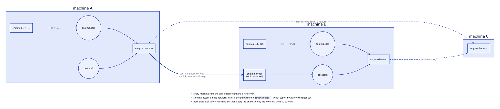
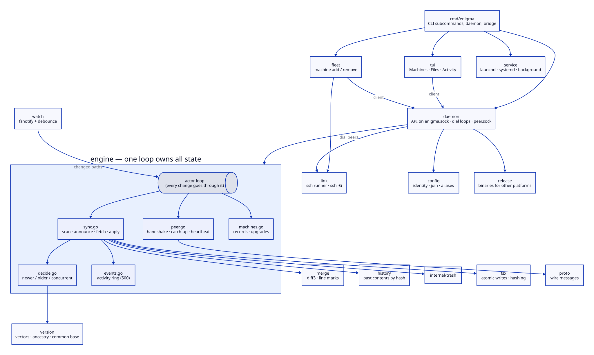
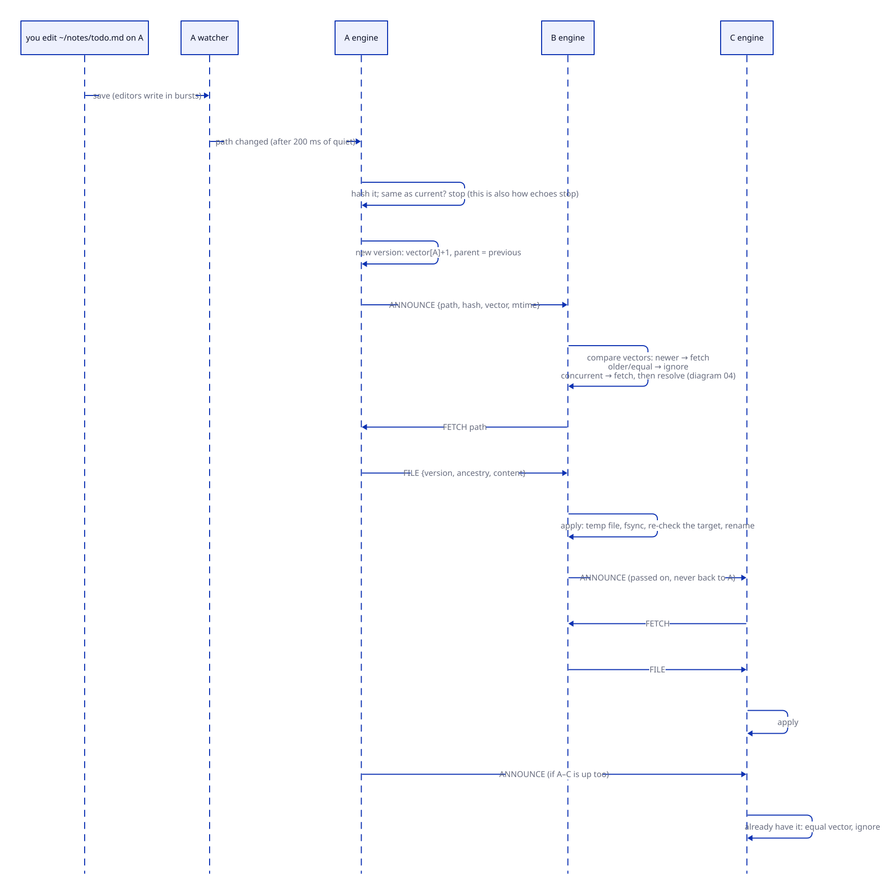
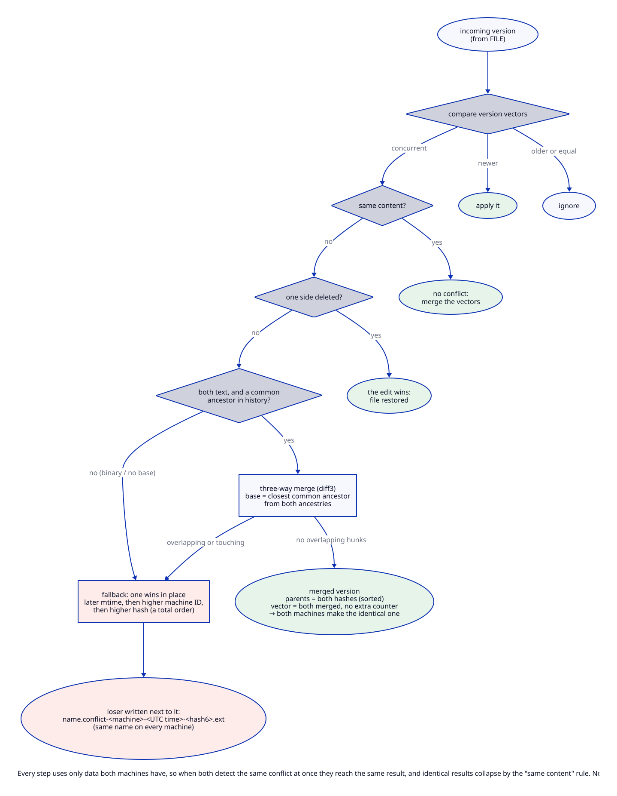
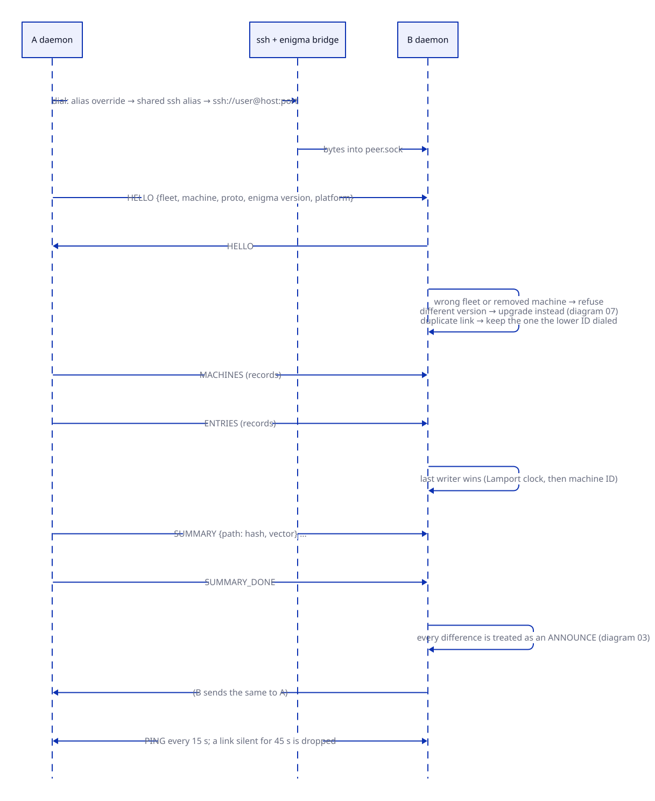
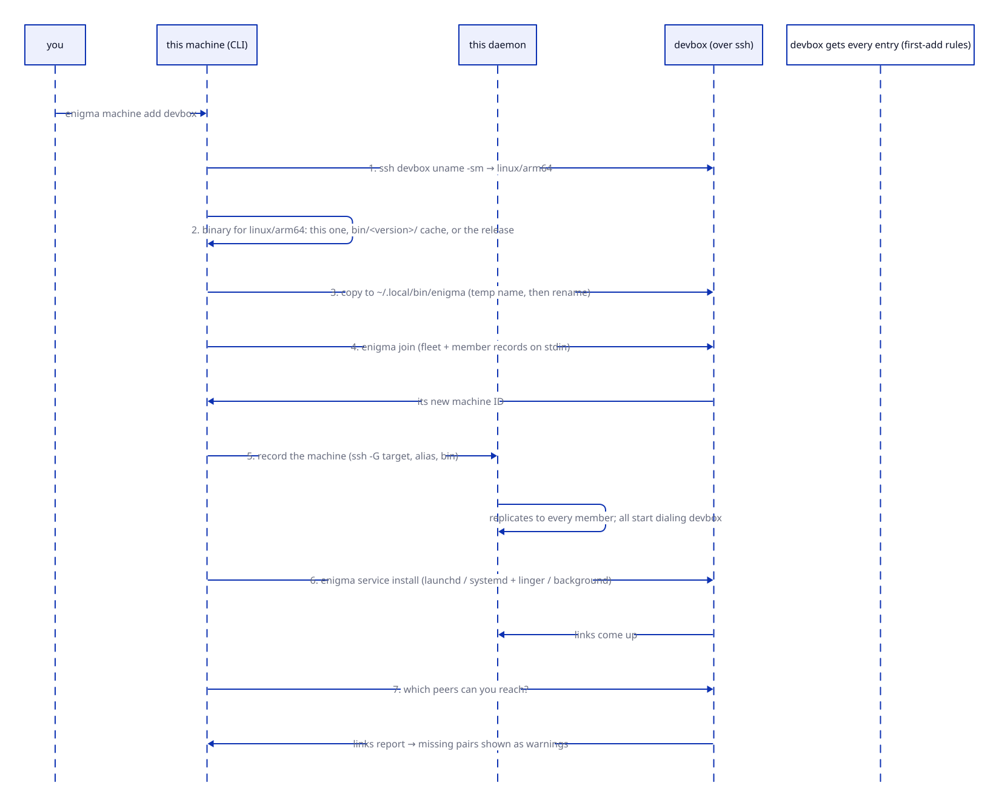
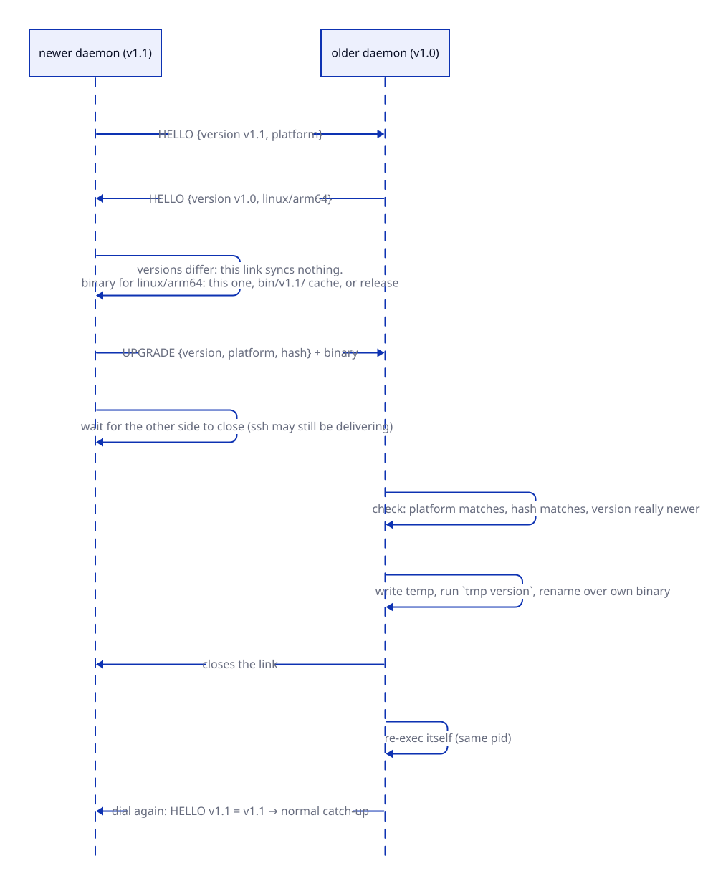
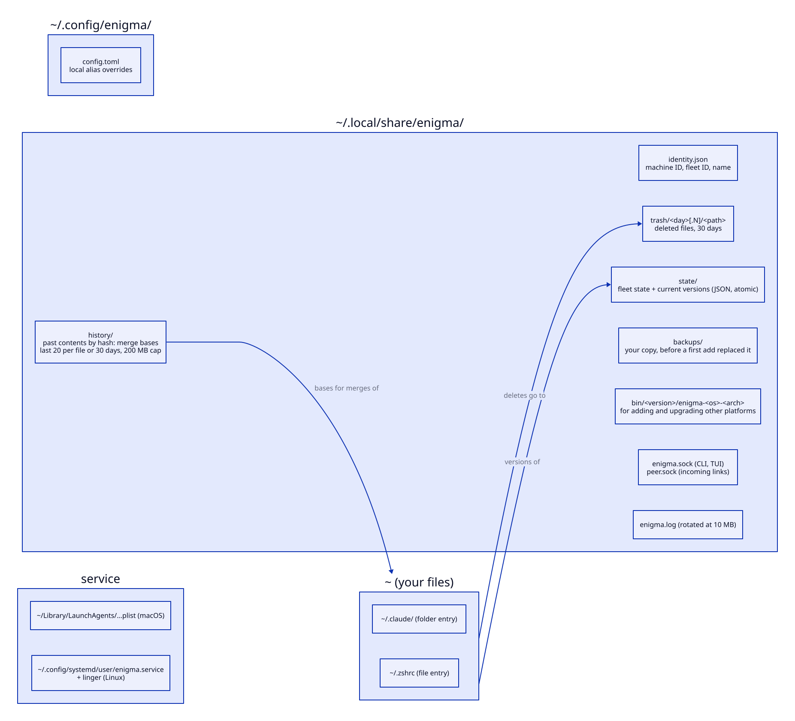

# How Enigma works

Diagrams of Enigma's moving parts, in reading order. `SPEC.md` is the design
of record; these pages explain it, and each one names the sections it
follows. Sources are `.d2`; run `make diagrams` after editing one.

## 1. Machines and links

Every machine runs the same `enigma daemon`. There is no server and nothing
listens on the network. To link to another machine, a daemon runs the system
`ssh` with `enigma bridge` as the remote command. The bridge only copies bytes
between ssh and the remote daemon's `peer.sock`. From then on the two daemons
exchange frames both ways over that one connection.

Every machine dials every other member. If both directions succeed, the link
dialed by the lower machine ID is kept, so ssh working in one direction is
enough. A change also travels through other machines (A → B → C) when A cannot
reach C directly.

The CLI and the TUI never touch state files. They are clients of the local
daemon's `enigma.sock` (HTTP + JSON).

## 2. Inside one daemon

The **engine** owns all sync state and changes it from a single loop: watcher
events, incoming frames and API calls all go through it, one at a time. This
is why the engine needs no locks around its state, and why a test can drive
several engines over in-memory pipes and get the same behaviour as over ssh.

- **watch:** fsnotify with a debounce, plus a rescan every 10 minutes.
- **version:** version vectors, and the per-file ancestry (the last 64
  hashes) used to find a merge base.
- **merge:** diff3.
- **history:** old contents, kept as merge bases.
- **trash:** deleted files.
- **fsx:** atomic writes.
- **daemon:** the API, the dial loops that keep links up, and the
  self-upgrade.
- **group:** `machine add` and `machine remove`, shared by the CLI and the
  TUI.

## 3. One edit, every machine

1. The watcher reports a changed path. The engine hashes the file: if the
   hash is unchanged, nothing happens. This is also what stops echoes, since
   Enigma's own writes produce the same hash.
2. Otherwise it makes a new version, bumping this machine's counter in the
   vector, and **announces** it on every link.
3. A receiver compares vectors. If the announced version is newer, it
   **fetches** it, writes it atomically and passes the announcement on, never
   back to where it came from.
4. A receiver that already has the version ignores the announcement, so a
   file is never sent twice to the same machine.

## 4. Concurrent edits

When neither vector is newer, the two edits happened concurrently. In order:

1. **Identical content** is not a conflict.
2. **An edit beats a delete.**
3. **Two text edits** are merged line by line against their closest common
   ancestor, whose content comes from the history store.
4. **Fallback.** When there is no merge base, the file is binary, or the edits
   touch the same lines, one version stays in place. The later mtime wins, then
   the higher machine ID, then the higher hash. The other version is written
   next to the file as a `.conflict-…` copy. Nothing is dropped.

Both machines often detect the same conflict at the same moment. Every rule
above uses only data both sides have, so both reach the identical result, and
step 1 then collapses the two into one.

## 5. A link coming up

A link starts with a **handshake**: both sides send `HELLO` with the group,
the machine ID and the Enigma version. A wrong group or a removed machine is
refused, and a version mismatch turns the link into an upgrade (section 7).

The two sides then **catch up**:
1. They exchange the group state: machine records and entries. For each
   record, the last writer wins.
2. They exchange a summary of every tracked file. Each difference is handled
   like an announcement.

A ping every 15 s keeps the link honest: a link silent for 45 s is dropped
and dialed again. Without the ping, the accepting side would keep a dead link
"up" for minutes after a network cut.

## 6. Adding a machine

`enigma machine add <ssh-alias>`, or `a` on a host in the TUI, does this:
1. Detects the remote platform.
2. Finds a binary for it: this one, the `bin/<version>/` cache, or the
   release.
3. Copies the binary to the remote.
4. Joins the remote to the group.
5. Records the new machine, so every member starts dialing it.
6. Installs the remote's service.
7. Asks the new machine which peers it can reach, and warns about any
   missing pairs.

Every step prints the exact command it runs.

## 7. Upgrades

Linked machines always run the same version. A link between different
versions syncs nothing. Instead, the newer side sends its binary for the
older side's platform. The older side checks it (platform, hash, version
strictly newer, and the binary runs), swaps it in and re-executes itself.
The link then comes back up with matching versions and catches up.

This works whichever side dialed, and it travels hop by hop: upgrading one
machine upgrades the whole group, including machines reachable only through
another member. A downgrade is never accepted.

## 8. Storage

Everything Enigma keeps is under `~/.config/enigma` and
`~/.local/share/enigma`. Both respect the XDG variables, and `ENIGMA_HOME`
moves everything under one folder for tests. Your files stay where they are.
Enigma only records versions of them, keeps old contents as merge bases, and
moves deleted files to its trash for 30 days.
